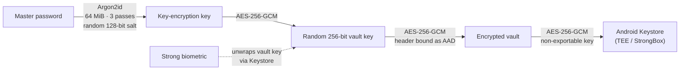

<div align="center">

# MySecurePass

**A private, offline password manager and generator for Android.**

No internet permission · No account · No tracking · Your keys never leave your phone

[](.github/workflows/ci.yml)


[](LICENSE)

</div>

---

## Why MySecurePass?

Most password managers ask you to trust their servers. MySecurePass has none. It **can't** send your data anywhere: the app doesn't request Android's internet permission, so the operating system blocks every network connection. You can check this yourself in the app's Security tab, and CI rejects any build that adds the permission.

Everything else is built on standard, well-studied cryptography: **Argon2id**, **AES‑256‑GCM** and the **Android Keystore**. You don't have to take that on trust either: the built-in self-test verifies it on your own phone.

## Features

### 🔑 Generator
| | |
|---|---|
| **Passwords** | 4–64 characters, character-class toggles, minimum digits/symbols, custom symbol sets, excluded characters, look-alike avoidance |
| **Passphrases** | EFF diceware wordlist (7,772 words), separators, capitalisation, optional number |
| **PINs** | Rejects guessable patterns: repeats, runs, keypad lines, years and dates |
| **Developer tokens** | Hex, base64url, alphanumeric, UUID v4 |
| **Honest strength** | Exact entropy of the generator (not a guess from the output), with crack times for three attacker models |
| **Extras** | Presets, QR sharing (including Wi‑Fi join codes), session history kept in memory only, Quick Settings tile |

### 🗄️ Vault
| | |
|---|---|
| **Item types** | Logins with **2FA (TOTP) codes**, **payment cards**, **Wi‑Fi networks**, **secure notes** |
| **Organise** | Tags, favourites, custom fields (optionally hidden), search, filters, sort by name / recently used / recently modified |
| **Fast actions** | One-tap copy, long-press quick actions, Undo on delete, trash with 30-day restore |
| **2FA setup** | Paste a setup key or **scan the QR code from a screenshot** (no camera permission) |
| **Password health** | Flags weak, reused and old passwords, and logins without 2FA |
| **Autofill** | Fills apps and browsers through Android Autofill, and offers to save new logins |
| **Your data, portable** | Encrypted `.msp` backups with reminders. CSV import from Chrome, Firefox, Bitwarden, 1Password and KeePassXC. CSV export behind re-authentication |

### 🛡️ Security Center
| | |
|---|---|
| **Live score** | Checks the app runs on itself: network permission, key storage hardware (StrongBox / TEE), screen lock, root indicators, USB debugging, screenshot protection, auto-lock, clipboard, backup age |
| **Verify encryption** | On-device known-answer tests for AES‑256‑GCM and Argon2id, tamper detection, FIPS 140‑2 RNG statistics, Keystore round-trip, and Argon2 timing on your phone |
| **Access log** | Every unlock, failed attempt and sensitive action, on-device only. The lock screen shows when the app was last unlocked |
| **Password checker** | Realistic strength estimates (zxcvbn) for passwords you already use, fully offline |
| **Self-destruct** | Optional erase after 10 consecutive failed unlocks |

## Security architecture



| Layer | Implementation |
|---|---|
| Randomness | Kernel CSPRNG (`SecureRandom`) with bias-free rejection sampling |
| Password sampling | Exactly uniform over every string that satisfies your rules (dynamic-programming count), so reported entropy is exact |
| Key derivation | **Argon2id**, 64 MiB, 3 passes, unique 128-bit salt per vault (above OWASP recommendations) |
| Encryption | **AES‑256‑GCM**: a random vault key wrapped by the derived key, with every byte authenticated and the header bound as AAD |
| Nonces | Fresh 96-bit IV on every save |
| Device binding | The vault file is sealed again by a non-exportable Keystore key, so a copied file is useless elsewhere |
| Biometrics | Class 3 only. The key needs authentication on every use and is revoked when biometrics change |
| Brute force | Argon2 cost, escalating lockouts after 5 failures, optional self-destruct |
| Malicious files | Imported KDF parameters are bounds-checked, so a backup can't demand gigabytes of memory |
| App lock | System splash, then a full-screen lock. Nothing is drawn behind the lock or the biometric prompt |
| Memory | Keys and password buffers are zeroed after use. The vault key is wiped on lock |
| Auto-lock | Timeout, screen-off and memory-pressure locking. Copied secrets are cleared on lock |
| Clipboard | Copies are marked *sensitive* (hidden from previews and keyboards) and cleared automatically |
| Screen | `FLAG_SECURE` by default: no screenshots, hidden in recent apps |
| Backups | `allowBackup=false`; cloud and device-transfer extraction disabled |
| Network | **No `INTERNET` permission.** It's explicitly stripped in the manifest and checked in CI |

<details>
<summary><b>Vault file format (v1)</b></summary>

```
"MSPV" | ver | kdf=argon2id | memKiB | iterations | parallelism | saltLen | salt
       | wrapIv(12) | wrappedKeyLen | AES-GCM(KEK, vaultKey, aad = prefix)
       | dataIv(12) | AES-GCM(vaultKey, json, aad = entire header)
```

On the device this file is wrapped once more: `Keystore-AES-GCM(file)`. Exported backups are the inner file only, so they're portable and protected by the master password alone. The JSON schema evolves additively, so older vaults always open.
</details>

### Threat model

| ✅ Protects against | ❌ Cannot protect against |
|---|---|
| A stolen or lost phone | Someone who knows your master password |
| A copied vault file or backup | A rooted phone or malware that controls the screen |
| Shoulder-surfing via screenshots, recents or clipboard history | Someone watching while you reveal a password |
| Network interception and server breaches (there is no server) | Losing your phone without an exported backup |
| Tampered or malicious backup files | |

## Getting started

### Install
Download the latest APK from [Releases](../../releases), open it on your phone, and allow installation from your browser or file manager. Requires **Android 8.0 or newer**.

### Build from source
Requirements: **JDK 17** and the **Android SDK 35** (Android Studio Ladybug or newer).

```bash
git clone https://github.com/<your-username>/MySecurePass.git
cd MySecurePass

./gradlew :core:test :app:testDebugUnitTest   # run all tests
./gradlew :app:assembleDebug                  # build app/build/outputs/apk/debug/app-debug.apk
```

<details>
<summary><b>Signed release builds</b></summary>

Create a `keystore.properties` file in the project root (it's git-ignored):

```properties
storeFile=/absolute/path/to/release.jks
storePassword=...
keyAlias=...
keyPassword=...
```

Then run `./gradlew :app:assembleRelease`. The release build is minified with R8 (about 3.7 MB). Keep your keystore safe: Android only installs updates signed with the same key.
</details>

## Project structure

```
MySecurePass/
├── core/                  Pure Kotlin/JVM, no Android dependencies, fully unit-tested
│   ├── generator/         Uniform constrained sampler, passphrases, PINs, tokens
│   ├── vault/             Encrypted format, data model, CSV import/export, health, cards
│   ├── security/          On-device cryptographic self-test (known-answer tests)
│   ├── strength/          Entropy ratings and crack-time models
│   └── totp/              RFC 6238 one-time codes and otpauth:// parsing
└── app/                   Android app
    ├── security/          Keystore, Argon2id (native), clipboard, device checks
    ├── data/              Vault repository, settings, access log, strength analysis
    ├── autofill/          Android Autofill service and unlock/save flows
    ├── tile/              Quick Settings tile
    └── ui/                Jetpack Compose screens and design system
```

## Testing

```bash
./gradlew :core:test :app:testDebugUnitTest
```

53 tests, including:

- **Generator correctness**: counts verified by brute-force enumeration, and a chi-square test that every valid password is equally likely
- **Cryptography**: tamper detection on every byte, unique salts and nonces, no plaintext in the vault file, password buffers wiped
- **Known-answer vectors**: AES‑GCM checked against the JDK, Argon2id against Bouncy Castle, TOTP against the RFC 6238 test vectors
- **Compatibility**: old vault schemas still decode, and CSV round-trips preserve tricky values
- **Accessibility**: WCAG AA contrast for every text colour in both themes

## Tech stack

Kotlin · Jetpack Compose (Material 3) · Coroutines · kotlinx.serialization · Android Keystore · BiometricPrompt · Android Autofill · [Argon2](https://github.com/lambdapioneer/argon2kt) · [zxcvbn4j](https://github.com/nulab/zxcvbn4j) · [ZXing](https://github.com/zxing/zxing)

## Roadmap

- [ ] Passkey (WebAuthn) support via Credential Manager
- [ ] Encrypted file attachments
- [ ] Optional local Wi‑Fi Direct sync between your own devices
- [ ] More languages
- [ ] Reproducible builds and F-Droid listing

## Contributing

Contributions are welcome. Please read [CONTRIBUTING.md](CONTRIBUTING.md) first. The one firm rule: **the app never gets network access.**

Found a vulnerability? Please report it privately as described in [SECURITY.md](SECURITY.md).

## License

[MIT](LICENSE) © 2026 Ram Sharma

Bundled third-party components: [EFF Large Wordlist](https://www.eff.org/dice) (CC BY 3.0), zxcvbn4j (MIT), Argon2 (CC0 / Apache 2.0), ZXing (Apache 2.0), [JetBrains Mono](https://www.jetbrains.com/lp/mono/) (OFL 1.1).
